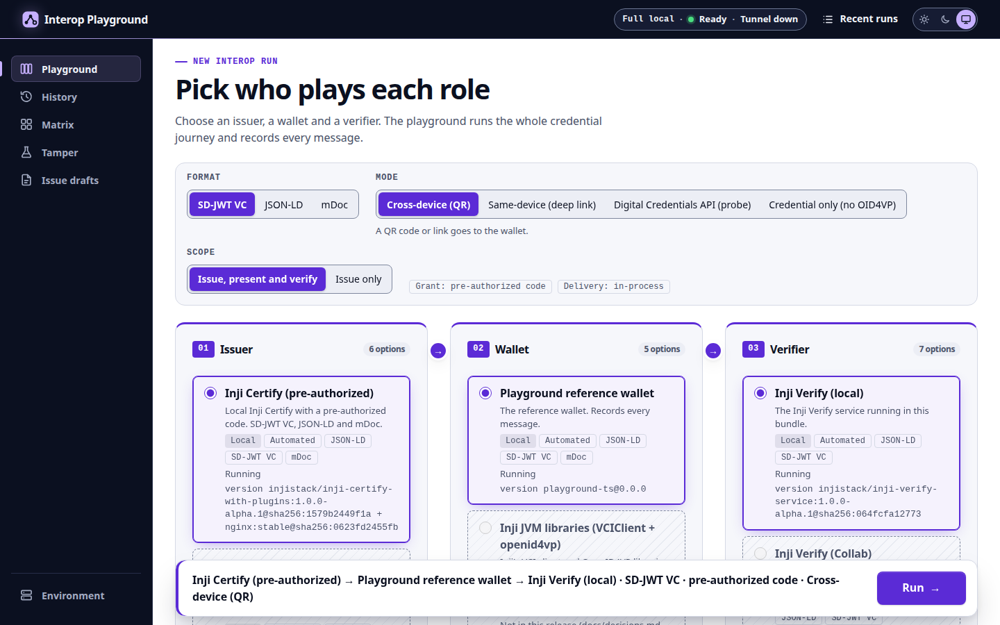

# Interop Playground

Interop Playground lets you run Inji issuer → wallet → verifier combinations, inspect every protocol message, and prove the fix for a failure with a re-run that changes one knob.

Team Bhrinjal (Abhijay Jindal), MOSIP Decode 2026, problem statement PS02.

> **v1 (2026-10-20).** This README describes only what is built and tested on that date. Demo video: [`deliverables/video/demo-v1.mp4`](deliverables/video/demo-v1.mp4).



## What it does

- **Combination selector.** Pick an issuer, a wallet and a verifier. Combinations that cannot work are greyed out, with the reason and a gap ID.
- **Live issue and present flows.** OID4VCI 1.0 pre-authorized-code issuance and OID4VP 1.0 cross-device presentation, run against real Inji services in Docker.
- **Protocol inspector.** Every HTTP exchange of a run, with decoded SD-JWT disclosures, JOSE headers and a key-payload bar. Each hop is labelled with how complete its capture is (`full`, `partial` or `none`).
- **Per-run report.** JSON and Markdown (API-45): fields, checks, diagnosis, fix-it result, coverage and steps.
- **Fix-it re-runs (the original angle).** When a failure matches a known fingerprint and a proven knob exists, one click re-runs the same run with exactly that knob changed and reports whether it fixed the failure. Proven live on the bundle (see [Fix-it re-runs](#fix-it-re-runs-the-original-angle)).

## Quickstart

1. **Check the prerequisites.**
   - Linux host with Docker 29 and the compose plugin, bash, git, openssl, `ss` and curl.
   - Memory: the full bundle wants about 4.5 GiB; `scripts/up.sh` warns below 12 GiB free.
   - Port 443 and port 3100 free on the host (`scripts/up.sh` stops with the owning process if not). With rootless Docker, allow binding port 443 first; `scripts/up.sh` prints the sysctl command if it is needed.
   - Only for the tests and the live end-to-end specs: Node.js 22 (`>=22.22.2 <23`, see `package.json` `engines`) and npm.
2. **Clone the repository.**

   ```bash
   git clone https://github.com/abhijay-jindal-604/interop-playground
   cd interop-playground
   ```

3. **Start the bundle.**

   ```bash
   scripts/up.sh
   ```

   On the first run it creates `.env` (with this machine's LAN address as `PUBLIC_HOST`) and `.env.local` (generated secrets, mode 0600), generates a local certificate authority in `certs/`, pulls the images pinned in [`versions.lock`](versions.lock), builds the local images, starts the `local` profile, onboards eSignet and runs a smoke download. It ends with `ready`. It is idempotent: a second run on a healthy bundle changes nothing. Add `--with peers` for the walt.id issuer used by the fix-it example. `scripts/up.sh --help` lists every flag (`--mode local|collab`, `--with peers|mdoc-spec|iae|debug`, `--reset`, `--no-build`, …).

4. **Open the UI** at <http://127.0.0.1:3100> and do [your first run](#your-first-run). The Environment page shows each service's state.
5. **Stop the bundle** with `scripts/down.sh`. It keeps the volumes, so the next `scripts/up.sh` is faster. `scripts/up.sh --reset` rebuilds the Inji state from scratch.

Sample data (identities, credential configurations, test keys) is described in [`docs/test-data.md`](docs/test-data.md); you do not need to create any account.

**What has been verified.**

- **Clean `scripts/up.sh`: ready, slice e2e green (2026-10-20).** After `down`, a plain `scripts/up.sh --no-build` reached ready in 1 min 22 s on a host with the images already pulled, and `npm run e2e:live -- slice` passed. With `--with peers`, `npm run e2e:live` (slice and fix-it) passed 2/2.
- A host whose eSignet database predates 2026-10-20 needs `scripts/up.sh --reset` once (the eSignet and mock-identity keystores moved onto volumes, G-159).
- `scripts/up.sh --reset` from no containers exits 0 in about 2.5 minutes. It onboards eSignet, re-asserts the Certify `didUrl` and runs the guest-smoke download.
- **Fresh clone to a FLOW-30 Pass in 3 min 1 s (2026-10-20).** `git clone`, then `scripts/up.sh` with no flags (2 min 40 s), then the first run below gave run `01M5CCC4FZRMCCWMVQF5038EYS`, **Pass**. Every image was already cached on that host; a host without them adds the pull time of the digests in `versions.lock`. Details: [`docs/evidence/T-55-fresh-clone.md`](docs/evidence/T-55-fresh-clone.md). Final fresh-clone check at `2f162cd` (FLOW-30 Pass in about 3 min 10 s, second-checkout warning and automatic rebuild, `ldp_vc` Pass on the clone): [`docs/evidence/T-55-final-check.md`](docs/evidence/T-55-final-check.md).
- **One checkout per host.** Every checkout uses the same compose project (`interop-playground`) and the same volumes, but keeps its playground CA in its own directory. `scripts/up.sh` stamps the shared Inji volumes with the checkout that built them. When you run it from a second checkout (for example a fresh clone), it prints a "one checkout per host" warning and rebuilds the Inji state for that checkout automatically (the same as `scripts/up.sh --reset`); switching back rebuilds it again. `scripts/up.sh --reset` still forces a rebuild at any time (G-166, our bundle defect, fixed).

## Your first run

1. On `/`, pick **Inji Certify (pre-authorized)**, then **Playground reference wallet**, then **Inji Verify (local)**.
2. Pick the format **SD-JWT VC** and the mode **Cross-device (QR)**, then press **Run**.
3. The run screen shows the sequence diagram as messages move. The result card reads **Pass**.
4. Open a step in the inspector. The key-payload bar shows the credential offer, the token, the proof JWT, the SD-JWT with its disclosures, the KB-JWT and the verifier result.
5. **Report** opens the per-run report (Markdown and JSON tabs, downloads).

The same path runs automatically against the live bundle: `npm run e2e:live -- slice` ([`e2e/live/slice.live.spec.ts`](e2e/live/slice.live.spec.ts)). The live specs are outside the quickstart: run `npm ci` and `npx playwright install chromium` once first. `npm run e2e:live` with no argument also runs the fix-it spec and needs `scripts/up.sh --with peers`.

## Architecture

```
 browser ──REST + SSE──▶  BFF (Node 22, Fastify)  ◀── wallet / verifier callbacks
  React 18 UI             ├─ orchestrator + scheduler (immutable RunSpecs)
  (served by the BFF)     ├─ adapters (issuers, wallets, verifiers)
                          ├─ capture layer (outbound HTTP) + edge gateway (inbound legs)
                          ├─ event sink → SQLite event log → SSE stream
                          ├─ diagnosis engine (fingerprints) + derive (one-knob re-runs)
                          └─ JVM sidecar (Inji Kotlin libraries), Docker network
                                   │
          Inji Certify · Inji Verify · Mimoto · eSignet · walt.id (peers profile) …
```

- **Capture is orchestration.** The BFF makes every outbound call itself. Inbound legs (wallet to issuer, wallet to verifier) pass through an allowlisting edge gateway. Each hop says whether its capture is `full`, `partial` or `none` (ADR-19).
- **Events.** Each step is persisted, then published. The UI follows a run over Server-Sent Events and replays it exactly from the stored log (ADR-20, ADR-36).
- **Immutable runs.** A run is a `RunSpec`. A fix-it re-run is a derived `RunSpec` with exactly one knob changed and a link to its parent (ADR-21).
- **Store.** SQLite (`better-sqlite3`) through a single sink that redacts secrets before anything is written. Holder private keys stay in one table and are never exported.
- **Network.** Inji services publish no ports. The BFF gateway is the only listener, behind a local CA for in-machine https (ADR-22).
- **Collab.** The public Collab sandbox is never written to (ADR-13). Collab mode is not part of v1 (see Known limitations).

Repository layout: `apps/bff` (BFF and `playground` CLI), `apps/ui` (web UI), `packages/adapters`, `packages/api` (contracts, OpenAPI, generated client), `packages/testkit` (fakes, fixtures, golden runner), `sidecar/` (Gradle, Inji JVM libraries), `compose.yaml` + `docker/`, `flows/`, `fingerprints/`, `fixtures/`, `scripts/`.

## Shipped flows

A run joins an issuance flow and a presentation flow. Flow definitions are in [`flows/`](flows/).

| Flow    | Picks                                                                                      | Format      | Grant / mode               | Tier      | Expected and evidence                                                                                                                                                                                                                                                                  |
| ------- | ------------------------------------------------------------------------------------------ | ----------- | -------------------------- | --------- | -------------------------------------------------------------------------------------------------------------------------------------------------------------------------------------------------------------------------------------------------------------------------------------- |
| FLOW-01 | Inji Certify (pre-authorized) → Playground reference wallet                                | (skeleton)  | pre-authorized, no tx_code | automated | issuance reference skeleton, which FLOW-04 extends                                                                                                                                                                                                                                     |
| FLOW-04 | Inji Certify (pre-authorized) → Playground reference wallet                                | `dc+sd-jwt` | pre-authorized             | automated | credential issued, `capture: full` (the issuance half of the slice)                                                                                                                                                                                                                    |
| FLOW-30 | … → Inji Verify (local)                                                                    | `dc+sd-jwt` | cross-device QR            | automated | **Pass**, Valid. Live e2e green 3× (T-36), after a clean `up.sh`, and from a fresh clone (run `01M5CCC4FZRMCCWMVQF5038EYS`). With the fixture's expired credential: **Valid-but-Expired** (run `01M5CBC7EQY4ZKHPE50C1PC9CJ`, [evidence](docs/evidence/T-47-vp-expired.md))             |
| FLOW-08 | walt.id issuer-api2 → Playground reference wallet (`--with peers`)                         | `dc+sd-jwt` | pre-authorized (by value)  | automated | issued; KNOB-01 switches the issuer key form (x5c absent/present). With FLOW-30: the fix-it pair below, live e2e green (T-44)                                                                                                                                                          |
| FLOW-14 | Fixture credential (`issuer.fixture`) → Playground reference wallet                        | `dc+sd-jwt` | no issuance traffic        | automated | credential signed at run time (valid, invalid or expired); live in the three FLOW-40 runs and the expired-credential FLOW-30 run                                                                                                                                                       |
| FLOW-40 | Fixture credential → Inji Verify (local), credential-level ("Credential only (no OID4VP)") | `dc+sd-jwt` | no OID4VP                  | automated | **Valid** `01M5CBEB3M9ANDEDPFBQD5D0NX`, **Invalid** `01M5CBEB4BW718XJ7VW09CB7EF`, **Valid-but-Expired** `01M5CBEB5F7W1Z8G14VNN0PK3Q` at the real Inji Verify (T-47, [evidence](docs/evidence/T-47-labels.md)); live e2e [`e2e/live/labels.live.spec.ts`](e2e/live/labels.live.spec.ts) |
| FLOW-03 | Inji Certify (pre-authorized) → Playground reference wallet                                | `ldp_vc`    | pre-authorized             | automated | credential issued (Certify's `Ed25519Signature2020` proof), every issuance step pass, live (T-46, run `01M5CDWNQDX53HC3YF288AFFFG`, [evidence](docs/evidence/T-46-ldp.md))                                                                                                             |
| FLOW-31 | … → Inji Verify (local)                                                                    | `ldp_vc`    | cross-device QR            | automated | **Pass**, Valid: run `01M5CDWNQDX53HC3YF288AFFFG` ([report](docs/reports/01M5CDWNQDX53HC3YF288AFFFG.md)) and UI e2e run `01M5CE5ZNPP9Z28SS1BWV3F5B8`; live e2e [`e2e/live/ldp.live.spec.ts`](e2e/live/ldp.live.spec.ts)                                                                |

The selector greys out combinations that the build rules out, each with its gap ID: no `mso_mdoc` at Inji Verify (G-09), pre-auth on Collab (G-06), no credential-offer support in Inji Web (G-08), the VCIClient https rule (G-103), and EdDSA-only request objects in the openid4vp library (G-112). The full list, with the combinations that ran, is in [`docs/interop-report.md`](docs/interop-report.md).

## Fix-it re-runs (the original angle)

A **fingerprint** describes a known failure: the step and exchange where it shows, the evidence it needs, the spec clause, and the component that deviates. After a failed run, the diagnosis engine reads only the persisted events and artifacts.

- **Exact match plus a proven knob:** the diagnosis card offers **one** button. It has no confirm dialog and re-runs the parent with that single knob changed.
- **Several possible causes, or evidence from a `partial` hop:** the card lists them. No button is offered.
- **No match:** "unclassified". No button is offered.

The child run is classified as `fixed`, `moved`, `not-fixed` or `inconclusive`. The compare strip shows the knob's direct effect first, and the claim sentence comes verbatim from API-31.

**Worked example: FP-01 + KNOB-01 (G-55), proven live (T-44, 2026-10-20).** Inji Verify alpha.1 requires an `x5c` header on SD-JWT credentials and rejects an issuer key given only as `did:jwk` or a JWK. walt.id issuer-api2 → Playground reference wallet → Inji Verify (local):

1. Parent run `01M5B6KNNY7DC3YK3CR0ETNBN9` (KNOB-01 `absent`): **FAIL** at `vp.verdict.evaluate`, `ERR_SIGNATURE_VERIFICATION_FAILED`. FP-01 matches exactly and offers KNOB-01. Report: [`docs/reports/01M5B6KNNY7DC3YK3CR0ETNBN9.md`](docs/reports/01M5B6KNNY7DC3YK3CR0ETNBN9.md).
2. One click derives child run `01M5B6M723AQ7T818D36816PRV` (KNOB-01 `present`, the walt.id `x5Chain` option): **PASS**, classified `fixed`. Report: [`docs/reports/01M5B6M723AQ7T818D36816PRV.md`](docs/reports/01M5B6M723AQ7T818D36816PRV.md).

Evidence: the live e2e [`e2e/live/fixit.live.spec.ts`](e2e/live/fixit.live.spec.ts) (green 4× on a service subset and 3× on `scripts/up.sh --with peers`), the golden replay of that recorded pair `apps/bff/src/diagnosis/fixit.golden.test.ts` (events in [`fixtures/golden/fixit/`](fixtures/golden/fixit/)), and the recording [`deliverables/takes/s10-fixit.webm`](deliverables/takes/s10-fixit.webm).

## Formats and labels

| Label in the UI            | Status in v1                                                                                                              |
| -------------------------- | ------------------------------------------------------------------------------------------------------------------------- |
| SD-JWT VC (`dc+sd-jwt`)    | issuance and cross-device presentation, live                                                                              |
| W3C VC (JSON-LD, `ldp_vc`) | issuance and cross-device presentation, live (FLOW-03, FLOW-31; [`docs/evidence/T-46-ldp.md`](docs/evidence/T-46-ldp.md)) |
| mDoc (`mso_mdoc`)          | not in v1 (cut 2026-10-20, see [`docs/decisions.md`](docs/decisions.md))                                                  |

Verifier results use the labels **Valid**, **Invalid** and **Valid-but-Expired** (REQ-23). All three were shown live at the real Inji Verify on 2026-10-20 (T-47): the fixture issuer signs a valid, an invalid and an expired SD-JWT at run time, and the credential-level path (FLOW-40) gives exactly Valid, Invalid (`ERR_SIGNATURE_VERIFICATION_FAILED`) and Valid-but-Expired ([`docs/evidence/T-47-labels.md`](docs/evidence/T-47-labels.md)). Presented over OID4VP (FLOW-30), the expired credential is also reported as Valid-but-Expired: Inji Verify accepts the submission and answers `expiryCheck.valid:false` with no error code ([`docs/evidence/T-47-vp-expired.md`](docs/evidence/T-47-vp-expired.md)). The UI shows the label on the result card; the selector mode for the credential-level path is **Credential only (no OID4VP)**.

## Reports

Each terminal run has a report: `GET /api/v1/reports/runs/{runId}?format=json|markdown`, plus the `/runs/:id/report` view. It is generated from the stored events, so the redaction rules apply.

[`docs/interop-report.md`](docs/interop-report.md) (v1) lists every combination the build ran, with its outcome, evidence and the greyed-out combinations. Committed run reports are in [`docs/reports/`](docs/reports/): the fresh-clone slice run [`01M5CCC4FZRMCCWMVQF5038EYS`](docs/reports/01M5CCC4FZRMCCWMVQF5038EYS.md), the label runs [`01M5CBEB3M9ANDEDPFBQD5D0NX`](docs/reports/01M5CBEB3M9ANDEDPFBQD5D0NX.md) (Valid), [`01M5CBEB4BW718XJ7VW09CB7EF`](docs/reports/01M5CBEB4BW718XJ7VW09CB7EF.md) (Invalid) and [`01M5CBEB5F7W1Z8G14VNN0PK3Q`](docs/reports/01M5CBEB5F7W1Z8G14VNN0PK3Q.md) (Valid-but-Expired), the `ldp_vc` run [`01M5CDWNQDX53HC3YF288AFFFG`](docs/reports/01M5CDWNQDX53HC3YF288AFFFG.md), and the fix-it pair [`01M5B6KNNY7DC3YK3CR0ETNBN9`](docs/reports/01M5B6KNNY7DC3YK3CR0ETNBN9.md) / [`01M5B6M723AQ7T818D36816PRV`](docs/reports/01M5B6M723AQ7T818D36816PRV.md). Each has a `.json` twin.

## Spec targets and versions

| Spec / component | Version                                                                                                                      |
| ---------------- | ---------------------------------------------------------------------------------------------------------------------------- |
| OID4VCI          | 1.0 final                                                                                                                    |
| OID4VP           | 1.0 final, DCQL                                                                                                              |
| SD-JWT VC        | `dc+sd-jwt` (IETF SD-JWT VC draft -19, RFC 9901)                                                                             |
| Inji             | Certify, Verify, Mimoto, Inji Web `1.0.0-alpha.1`; eSignet `1.8.0`; one digest-pinned develop-class Certify (not used in v1) |
| Peers            | walt.id issuer-api2 / verifier-api2 `1.1.0`, EUDI verifier endpoint `v0.11.0` (only walt.id issuance is wired in v1)         |

Every image is pinned in [`versions.lock`](versions.lock). The problem statement names earlier OpenID drafts. We implement the finals, and any draft behaviour is reported only as a labelled observation.

## Security notes

- Inji admin APIs are unauthenticated, so nothing is published beyond the gateway's allowlisted listeners. The gateway hard-denies admin paths.
- Secrets live only in the generated `.env.local` (mode 0600). The store sink redacts secrets before it persists anything, and `npm run store:scan` checks the store for leaks.
- Holder private keys never leave the `holder_keys` table and are never exported.
- No tunnel is started by default.

## Known limitations

From [`docs/decisions.md`](docs/decisions.md) (decision days 2026-10-13 and 2026-10-20):

- **Built adapters.** Issuers: Inji Certify (pre-authorized), walt.id issuer-api2, the fixture issuer. Wallet: the Playground reference wallet. Verifier: Inji Verify (local). The Inji JVM wallet, Inji Web, the phone wallet, Credo, Collab Verify, the Verify SDK, and the walt.id and EUDI verifiers are not in this release. The selector and API-02/API-03 show them as unavailable with the reason "Not in this release (docs/decisions.md 2026-10-20)".
- **Formats.** No mDoc (T-48 cut). `ldp_vc` runs live only with Inji Certify (pre-authorized) → Playground reference wallet → Inji Verify (local), cross-device.
- **Fix-it re-runs.** One fingerprint (FP-01) and one knob (KNOB-01) only. The G-59 knob is diagnosis-only, because Certify hardcodes `cnf.kid`.
- **Not in v1:** tamper mode, suites, the interop matrix, nightly CI against Collab, issue drafts, `tx_code`, auth-code issuance, presentation during issuance, same-device presentation, the tunnel and the DC API probe. If tamper mode ships later, the 33 tamper cells with no observation carry `expectation: unverified`, and the known upstream fails are listed in [`ci/known-fails.json`](ci/known-fails.json).
- **Collab mode** (`--mode collab`) exists in `up.sh`, but no Collab adapter is built in v1.
- **Bundle size.** The full `local` profile needs several GB of RAM.

## Gaps we found

We reproduced or relied on known gaps in the Inji stack while building, and documented each one with evidence. Examples: Inji Verify requires `x5c` on SD-JWTs (G-55, reproduced live by the fix-it pair above), Certify returns 500 where the spec needs 400 (G-109), and Certify's `tx_code` errors use the wrong code (G-115). The full list is in [`docs/gaps.md`](docs/gaps.md). Issues are filed upstream by hand only.

## Tech stack and the problem statement's recommended stack

| Area      | Choice                                                                    | Note                                          |
| --------- | ------------------------------------------------------------------------- | --------------------------------------------- |
| Backend   | Node 22, TypeScript, Fastify, `better-sqlite3`                            | the BFF drives every role                     |
| UI        | React 18, Vite 7, React Router, Mermaid (built-in SVG fallback), `qrcode` | no Tailwind; plain CSS tokens, light and dark |
| Live data | Server-Sent Events, REST commands                                         | no WebSocket                                  |
| Inji libs | JVM sidecar (Gradle) with the Inji Kotlin libraries                       | built; not used by v1 flows                   |
| Stack     | Docker Compose, one `scripts/up.sh`                                       | images pinned in `versions.lock`              |

## Development and tests

```bash
npm ci
npm run lint        # eslint + no-GitHub-write lint + secret scan + flow validation
npm run typecheck   # tsc -b
npm test            # vitest: unit, contract, integration, repo and ui projects
npm run test:ui     # only the UI component tests
npm run e2e         # Playwright on fixture routes (axe, 320–1440 px, light + dark)
npm run e2e:live    # Playwright against the running bundle (needs --with peers; one spec: -- slice | labels)
```

On 2026-10-21, in a fresh clone of commit `aaffa79`, `npm run lint` and `npm run typecheck` were clean, `npm test` reported 682 tests passing and 8 skipped (60 files), and the fixture Playwright suite 54 passing. The test cases, the edge cases they cover and the live results are in [`docs/testing.md`](docs/testing.md). `npm run e2e:live` needs `npm ci` and `npx playwright install chromium` first; `apps/bff/src/server.test.ts` needs port 3100 free, so run `npm test` with the bundle down. Bundle integration tests are opt-in (`BUNDLE_IT=1`).

## Documents

- [`docs/overview.md`](docs/overview.md): 1–2 page overview of the problem, the approach and the results
- [`docs/architecture.md`](docs/architecture.md): architecture diagrams (components, data flow of a run, issuance and presentation sequence, fix-it derive)
- [`docs/design.md`](docs/design.md): screenshots, wireframes and user flows
- [`docs/api.md`](docs/api.md): API documentation (endpoints, request and response formats, authentication, SSE events, examples, external APIs used)
- [`docs/testing.md`](docs/testing.md): test cases, edge cases and results
- [`docs/test-data.md`](docs/test-data.md): sample data needed to test (identities, credential configurations, test keys, recorded runs)
- [`docs/interop-report.md`](docs/interop-report.md): interop report v1 (combinations, outcomes, evidence)
- [`docs/gaps.md`](docs/gaps.md): gaps we found in the Inji stack, with drafted issues
- [`docs/decisions.md`](docs/decisions.md): dated decision log
- [`deliverables/deck-v2.html`](deliverables/deck-v2.html): pitch deck (self-contained; arrow keys to move, `n` for speaker notes). The earlier [`deck-v1.html`](deliverables/deck-v1.html) is kept.
- [`deliverables/video/demo-v1.mp4`](deliverables/video/demo-v1.mp4): demo video, with its script [`demo-v1-script.md`](deliverables/video/demo-v1-script.md) and captions [`demo-v1.srt`](deliverables/video/demo-v1.srt)
- [`packages/api/openapi.yaml`](packages/api/openapi.yaml): the machine-readable API contract (OpenAPI 3.1)

### Supporting material

- [`docs/reports/`](docs/reports/): committed run reports (JSON and Markdown)
- Shot takes in [`deliverables/takes/`](deliverables/takes/) (1440 px, host masked, QR blurred): [`s02-environment`](deliverables/takes/s02-environment.webm), [`s03-select`](deliverables/takes/s03-select.webm), [`s04-issuance`](deliverables/takes/s04-issuance.webm), [`s05-decoded`](deliverables/takes/s05-decoded.webm), [`s06-present`](deliverables/takes/s06-present.webm), [`s07-report`](deliverables/takes/s07-report.webm) (cut from [`s03-s07-slice`](deliverables/takes/s03-s07-slice.webm)), [`s09-labels`](deliverables/takes/s09-labels.webm), [`s10-fixit`](deliverables/takes/s10-fixit.webm). Earlier recordings: [`m1-slice`](deliverables/takes/m1-slice.webm), [`m2-fixit`](deliverables/takes/m2-fixit.webm).
- Live evidence in [`docs/evidence/`](docs/evidence/): [REQ-23 labels](docs/evidence/T-47-labels.md), [VP-level expired credential](docs/evidence/T-47-vp-expired.md), [fresh-clone timing](docs/evidence/T-55-fresh-clone.md), [final fresh-clone check at `2f162cd`](docs/evidence/T-55-final-check.md), [`ldp_vc` live](docs/evidence/T-46-ldp.md)

## References

Inji documentation:

- Inji docs overview: <https://docs.inji.io/>
- Inji Certify overview: <https://docs.inji.io/inji-certify/overview>
- Inji Verify overview: <https://docs.inji.io/inji-verify/overview>
- Inji Wallet (mobile) integration guide: <https://docs.inji.io/inji-wallet/inji-mobile/technical-overview/integration-guide>
- Inji Web features: <https://docs.inji.io/inji-wallet/inji-web/overview/features>
- OpenID4VP integration guide (Inji Verify): <https://docs.inji.io/inji-verify/technical-overview/integration-guides/openid4vp-vp-verification-integration-guide>

Repositories:

- Inji Wallet (mobile, React Native): <https://github.com/inji/inji-wallet>
- Inji Web (browser wallet): <https://github.com/inji/inji-web>
- Inji Certify (OpenID4VCI issuance): <https://github.com/inji/inji-certify>
- Inji Verify (verifier UI, verify-service, SDK): <https://github.com/inji/inji-verify>
- Inji OpenID4VP library: <https://github.com/inji/inji-openid4vp>
- Inji config (issuer and wallet configuration): <https://github.com/inji/inji-config>
- React Inji Verify SDK: `mosip/react-inji-verify-sdk` (npm)

## Credits

Team Bhrinjal: Abhijay Jindal. Built for MOSIP Decode 2026, problem statement PS02.

## License

Licensed under MPL-2.0; see [LICENSE](LICENSE).
