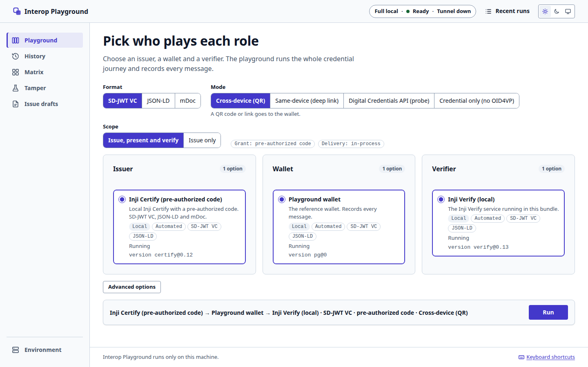
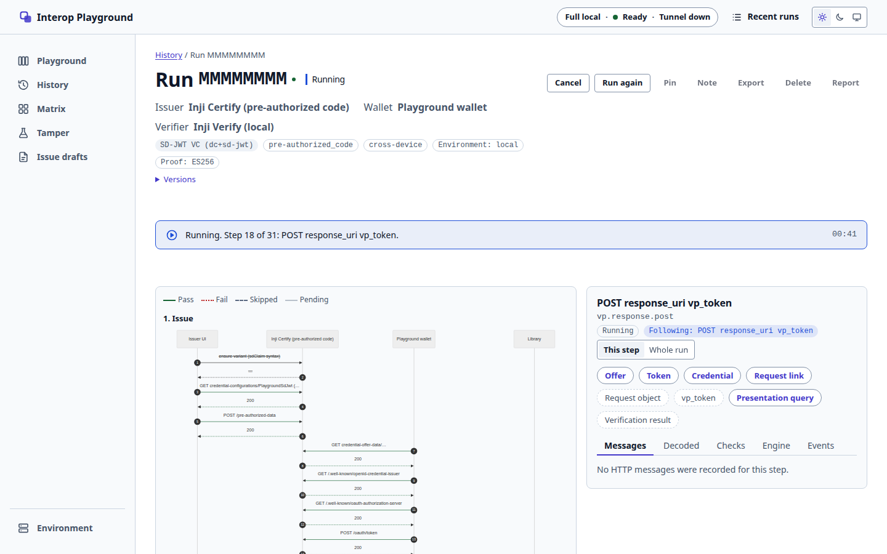
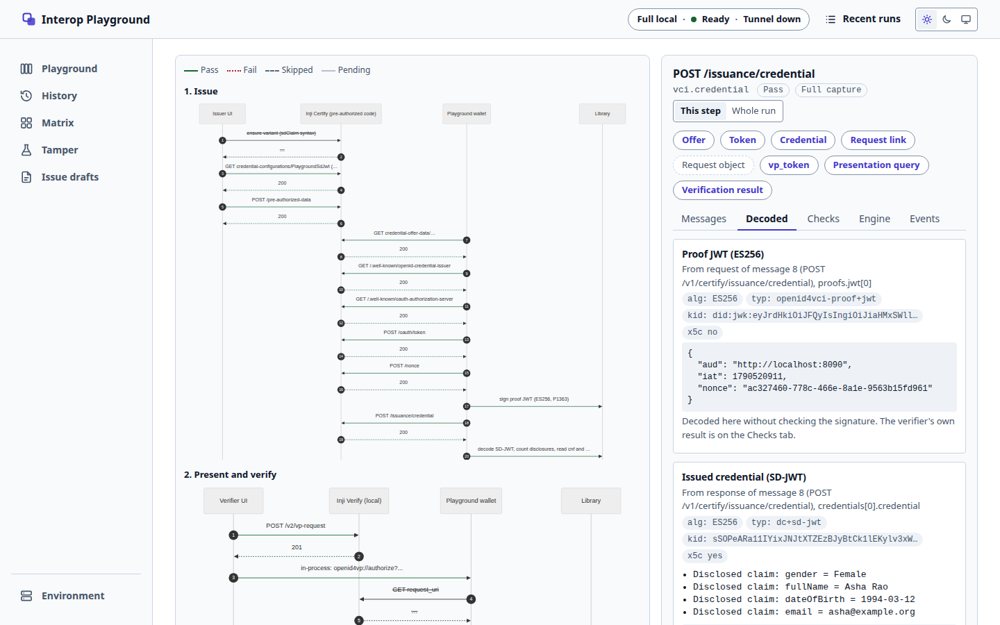
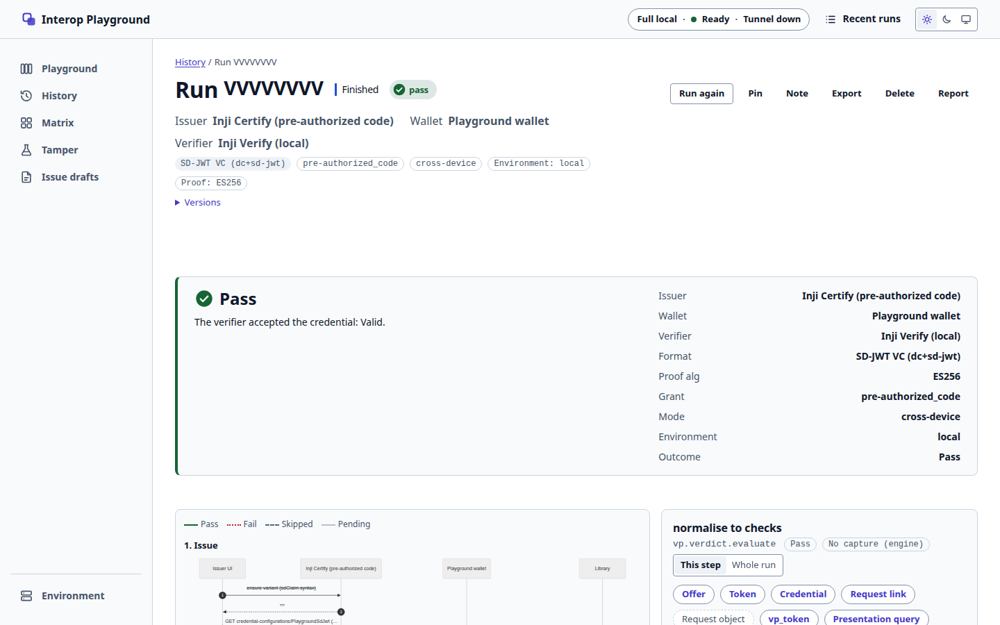
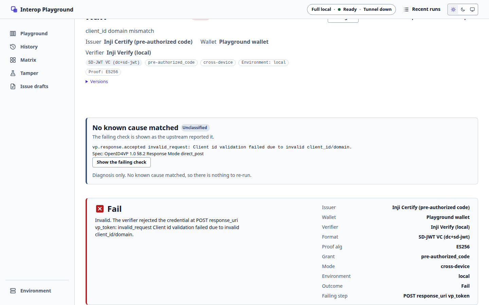
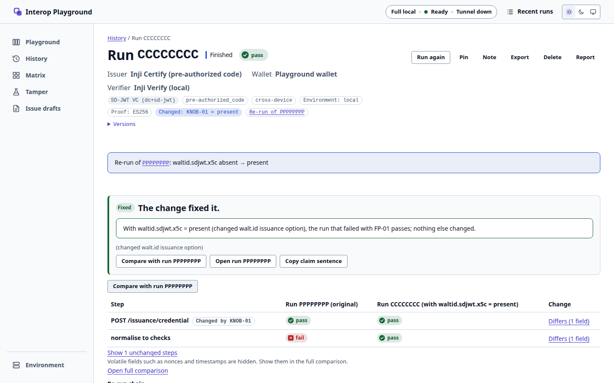
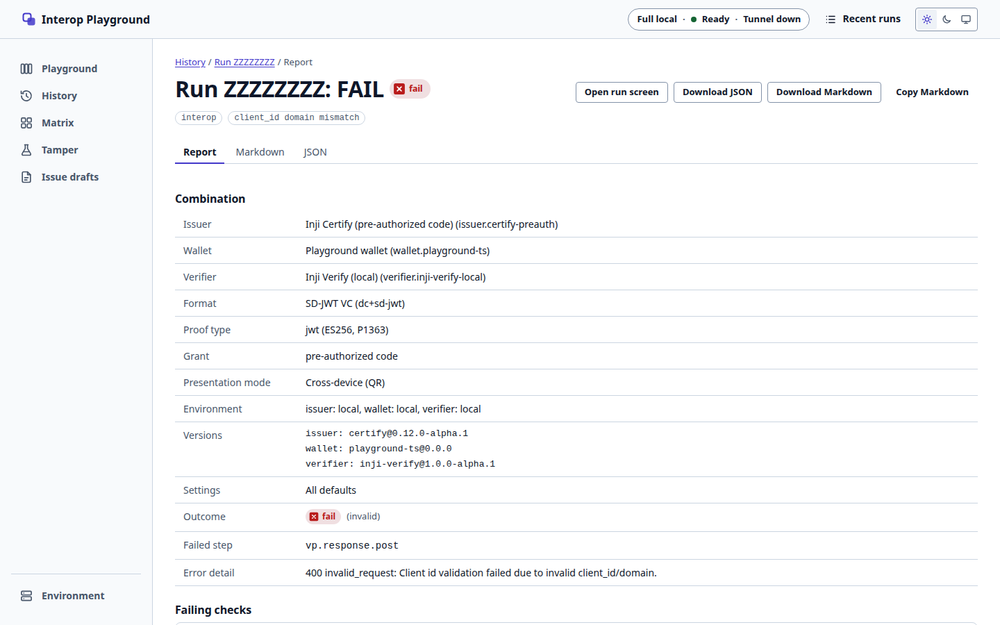
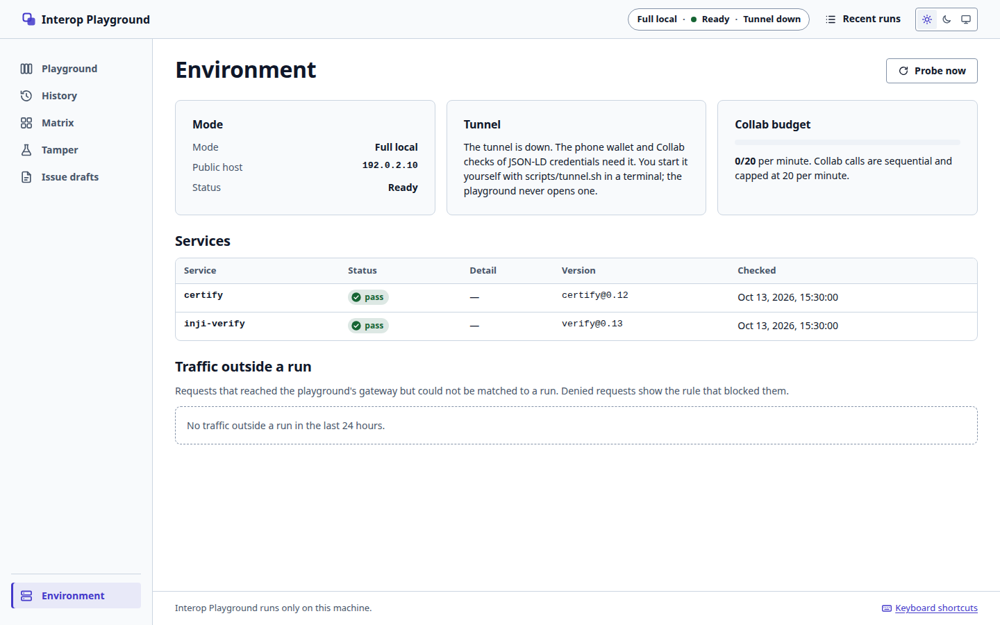
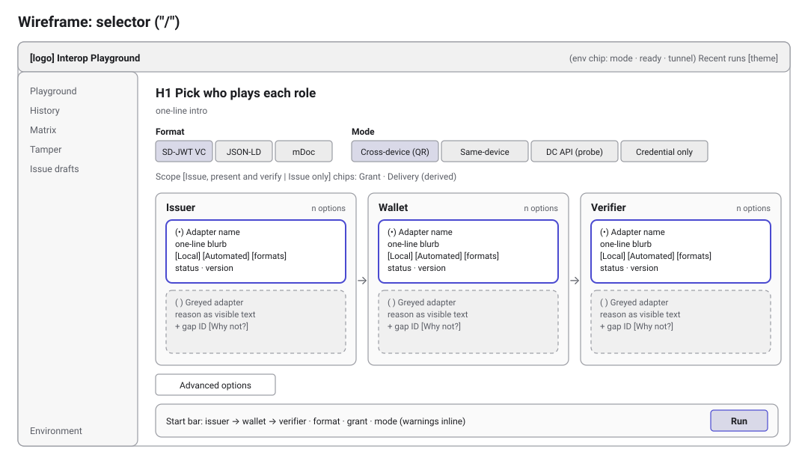
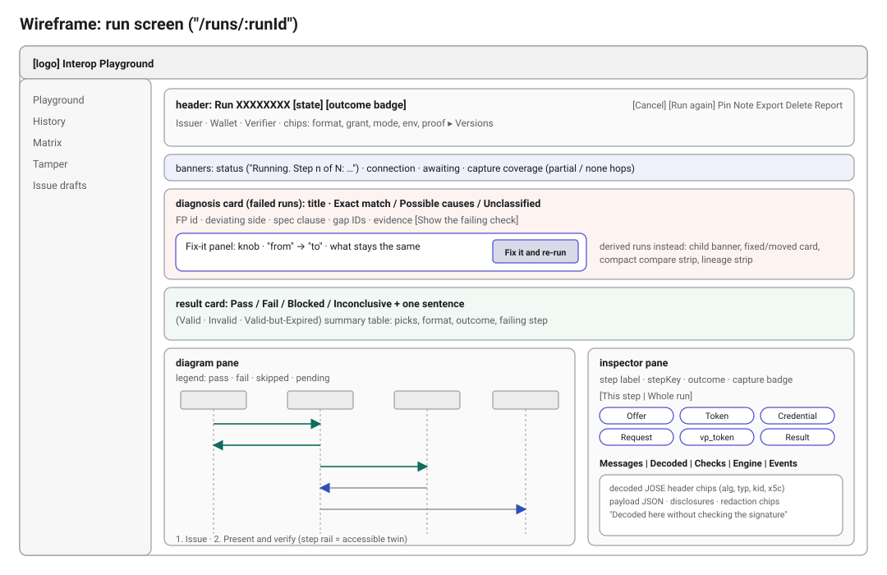

# Design: screens, wireframes and user flows

_v1, 2026-10-21. Screenshots of the main screens, low-fidelity wireframes of the two core layouts, and three user flows, each with a short design rationale._

## How the screenshots were made

Every screenshot below was captured with Playwright at 1440 × 900 px in the light theme. It shows the production UI build (`apps/ui`, served by `vite preview`) answering from the same fixture API that `npm run e2e` uses ([`e2e/support.ts`](../e2e/support.ts)): the recorded event logs in [`fixtures/events/`](../fixtures/events/) and the UI test fixtures in `apps/ui/src/test/`. No Docker bundle runs behind them. The public host is the documentation address `192.0.2.10`, and no secrets are shown.

Fixture data differs from the live runs in a few places. The fix-it screens reuse the Inji Certify fixture log, while the live pair used the walt.id issuer. The Valid-but-Expired card is the pass log with its verdict set to `valid-but-expired`. For the live results, see the evidence linked under each screen. The live selector is [`screenshots/selector.png`](screenshots/selector.png).

## Screens

### Selector (`/`)

Three radio-group columns let you pick exactly one issuer, one wallet and one verifier. Format, mode and scope sit above them; the grant is derived from the issuer, not picked. Combinations that cannot work stay in place, greyed out, with the reason as visible text and the gap ID. The compatibility rules are checked by the backend for every card, so the UI never keeps its own copy of them. The start bar repeats the whole choice in one line before **Run**.

### Run screen while running (`/runs/:runId`)

The run screen is one page for a live run, a finished run and a replay. All three come from one reducer over the run's event log. While the run is going, the banner names the step ("Running. Step n of N: …"), the diagram animates as messages arrive, and the inspector follows the running step. The step rail is the accessible twin of the diagram, which is `aria-hidden`.

### Inspector, Decoded tab

The inspector shows the raw payloads of each step. The key-payload bar (Offer, Token, Credential, Request link, Request object, vp_token, Presentation query, Verification result) jumps straight to the message that matters. A chip is muted when the run has no such message. The Decoded tab splits JOSE headers into chips (`alg`, `typ`, `kid`, `x5c`) and lists SD-JWT disclosures. It also says that decoding here does not check the signature; the verifier's own result is on the Checks tab. Each step carries its capture badge (`Full capture`, `Partial capture` or `No capture`).

### Result cards: Valid, Invalid, Valid-but-Expired

| Valid                                                            | Invalid                                                                                                                                          | Valid-but-Expired                                                                                                                                      |
| ---------------------------------------------------------------- | ------------------------------------------------------------------------------------------------------------------------------------------------ | ------------------------------------------------------------------------------------------------------------------------------------------------------ |
|  |  |  |

Every terminal run has a result card: an outcome badge with an icon and a word (colour is never the only signal), one sentence, and a summary table. The verifier label decides the sentence: Valid, Invalid with the verifier's own error code and message, or Valid-but-Expired, which is a pass with a warning and is not merged into Invalid. All three labels were shown live at the real Inji Verify ([evidence](evidence/T-47-labels.md)).

### Diagnosis and fix-it panel

The diagnosis card sits above the diagram on failed runs, because it is the first thing to read. It names the matched fingerprint, the deviating side, the spec clause, the gap IDs and the evidence. The fix-it panel appears only for an exact match with a proven knob. It shows the single change ("from" → "to"), says what stays the same, and has one button with no confirm dialog. When more than one cause fits, the card lists them and offers no button ([`e2e/angle.spec.ts`](../e2e/angle.spec.ts)).

### Child run and compare

A derived run opens with a banner that links its parent and names the one knob that changed. The result card classifies the child as `fixed`, `moved`, `not-fixed` or `inconclusive`; only `fixed` carries the claim sentence. The compact compare strip lists the knob's direct effect first, then the other changed steps, and hides volatile fields such as nonces and timestamps. Live pair: [parent](reports/01M5B6KNNY7DC3YK3CR0ETNBN9.md), [child](reports/01M5B6M723AQ7T818D36816PRV.md).

### Report view (`/runs/:runId/report`)

The report is the shareable record of one run: the combination, the versions, the outcome, failing checks, diagnosis, fix-it result, coverage and steps. The same content is available as a rendered view, as Markdown and as JSON, with download and copy buttons. Committed examples are in [`reports/`](reports/).

### Environment page (`/environment`)

The environment page answers "is my bundle healthy?" before you start a run. It shows the mode, the readiness probe of each service with its version, the tunnel state (down by default; the playground never opens one), and any traffic the gateway saw outside a run, with the rule that denied it.

## Wireframes

Low-fidelity layouts of the two core screens. They show the regions and their order, not the visual style.

Why this order on the run screen: the header says what ran; banners say what is happening now (status, connection, capture coverage). The diagnosis goes above the result for failed runs, because it explains the result. The workspace splits into the diagram (where in the flow) and the inspector (what was on the wire). Below 1024 px the two panes stack. Every screen is checked with axe at 320 to 1440 px in light and dark themes (`npm run e2e`).

## User flows

- **A. First run.** The same path is automated against the live bundle by [`e2e/live/slice.live.spec.ts`](../e2e/live/slice.live.spec.ts). The steps are in the README section [Your first run](../README.md#your-first-run).
- **B. Fix-it journey.** Automated on fixtures by [`e2e/angle.spec.ts`](../e2e/angle.spec.ts) and live by [`e2e/live/fixit.live.spec.ts`](../e2e/live/fixit.live.spec.ts).
- **C. Reading a report.** From the run screen's **Report** action, or `GET /api/v1/reports/runs/{runId}?format=json|markdown`.

## Design rules that apply to every screen

- **Status is never colour alone.** Each outcome has an icon, a word and a colour token, and the tokens pass the contrast script (`npm run contrast`).
- **Plain copy.** Errors that come from a user action show inline, with the request reference. Background errors (environment) use a toast.
- **Keyboard.** Global shortcuts use `Alt+Shift` (`N` new run, `H` History, `K` the shortcut list) and never fire while you type in a field; `Esc` closes the topmost dialog, drawer or menu ([`apps/ui/src/shell/shortcuts.ts`](../apps/ui/src/shell/shortcuts.ts)).
- **Light and dark themes** come from one set of CSS tokens (`apps/ui/src/tokens.css`).

See also [`architecture.md`](architecture.md) for the system diagrams.
